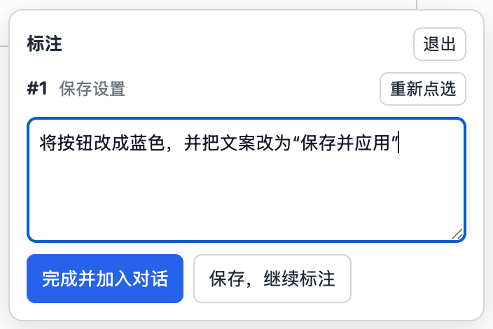
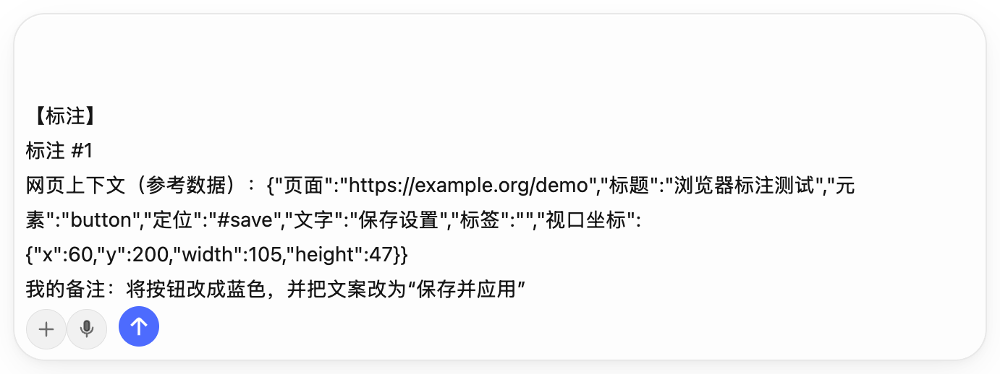

#  DSH 网页标注 · Browser Annotation

在 DSH Desktop 的内嵌浏览器里点选网页元素、写下备注，再将标注加入**当前对话的草稿**。你可以在输入框里继续编辑，确认后再发送。

Select elements in the DSH Desktop browser, add notes, and insert them into your **current chat draft**. You can edit the draft before sending it.

## 安装 · Installation

在 DSH Desktop 插件市场搜索 `dsh-browser-annotation`，选择作者为 **chnuuh** 的条目。也可以打开「添加插件」，输入下方地址安装v0.1.2。

Search the DSH Desktop plugin market for `dsh-browser-annotation` and choose the entry by **chnuuh**. To install v0.1.2 directly, open **Add Plugin** and enter the following address.

```text
github:chnuuh/dsh-browser-annotation#v0.1.2
```

如果以前安装过旧版 Annotation 补丁，请先查看[迁移说明](docs/MIGRATION.md)。<br>
If you previously installed the legacy Annotation patch, follow the [migration guide (in Chinese)](docs/MIGRATION.md) first.

## 从网页标注到对话草稿 · From page to chat draft

从 0.1.2 起，标注界面和草稿里的字段名跟随被标注网页的语言。优先读取网页声明的语言；网页未声明时，会参考标题和正文。仍无法识别时，按浏览器的中英文偏好显示，最后默认中文。网页原文和你写的备注会原样保留。

Starting with 0.1.2, the annotation controls and draft labels follow the language of the page you annotate. The plugin uses the page’s declared language first. On pages without a declaration, it checks the title and a short text sample. If it cannot identify Chinese or English, it uses your browser’s first supported language, then defaults to Chinese. Page text and your notes stay in their original language.

### 1. 右键选取元素 · Select an element

在网页上右键点击元素。选 **快速标注** 可直接把该元素的信息加入草稿。需要写备注时，选 **标注**，移动十字光标预览选框，再点击要标注的元素。

Right-click an element on the page. Choose **Quick annotation** to insert its details directly into the draft. To add a note, choose **Annotation**, move the crosshair to highlight an element, then click to select it.


### 2. 填写备注 · Add a note

在右下角的面板里写下备注。若要标注下一个元素，点 **保存，继续标注**，再用十字光标点选。面板上方会逐行显示已保存的元素和备注摘要，每批最多 20 条。

Write your note in the lower-right panel. To select another element, click **Save and continue**, then use the crosshair again. Each saved element and a short preview of its note appear on one line at the top of the panel. A batch can contain up to 20 notes.



### 3. 加入当前对话 · Insert into the current chat

点 **完成并加入对话**，十字光标和面板随即关闭。网页地址、元素信息和备注会一起插入输入框，原有草稿内容也会保留。

Click **Finish and add to chat** to close the picker and panel. The page URL, element details, and notes are inserted into the current chat draft alongside anything you’ve already written.



## 使用提示 · Usage tips

- 启用插件后，在网页上右键即可开始。刷新、关闭网页或停用插件前，请先把需要保留的标注加入草稿。<br>
  Once the plugin is enabled, right-click the page to get started. Add any notes you want to keep to the draft before refreshing or closing the page, or disabling the plugin.
- 使用时保持一个内嵌网页可见。按住 **Shift** 再右键，可打开网页原有的菜单。<br>
  Keep one embedded page visible while annotating. Hold **Shift** while right-clicking to open the page’s usual context menu.
- 标注会跟随开始时的对话。若中途切换了对话，请切回原对话完成标注。<br>
  Annotations stay with the chat where you started. If you switch chats, return to the original chat to finish.
