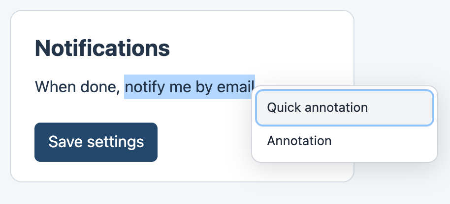

#  DSH 网页标注 · Browser Annotation

在 DSH Desktop 的内嵌浏览器里点选网页元素、写下备注，再将标注加入**当前对话的草稿**。你可以在输入框里继续编辑，确认后再发送。

Select elements in the DSH Desktop browser, add notes, and insert them into your **current chat draft**. You can edit the draft before sending it.

## 安装 · Installation

在 DSH Desktop 插件市场搜索 `dsh-browser-annotation`，选择作者为 **chnuuh** 的条目。也可以打开「添加插件」，输入下方地址安装 v0.1.3。

Search the DSH Desktop plugin market for `dsh-browser-annotation` and choose the entry by **chnuuh**. To install v0.1.3 directly, open **Add Plugin** and enter the following address.

```text
github:chnuuh/dsh-browser-annotation#v0.1.3
```

如果以前安装过旧版 Annotation 补丁，请先查看[迁移说明](docs/MIGRATION.md)。<br>
If you previously installed the legacy Annotation patch, follow the [migration guide (in Chinese)](docs/MIGRATION.md) first.

## 从网页标注到对话草稿 · From page to chat draft

从 0.1.2 起，标注界面和草稿里的字段名跟随被标注网页的语言。优先读取网页声明的语言；网页未声明时，会参考标题和正文。仍无法识别时，按浏览器的中英文偏好显示，最后默认中文。网页原文和你写的备注会原样保留。

Starting with 0.1.2, the annotation controls and draft labels follow the language of the page you annotate. The plugin uses the page’s declared language first. On pages without a declaration, it checks the title and a short text sample. If it cannot identify Chinese or English, it uses your browser’s first supported language, then defaults to Chinese. Page text and your notes stay in their original language.

### 1. 右键打开标注 · Start an annotation

在元素上右键选 **标注**，右下角会立即打开备注框。只想引用一句话时，先拖选文字，再在选区内右键。选 **快速标注** 则会直接把右键元素的信息加入草稿。

Right-click an element and choose **Annotation** to open the note field immediately. To annotate just a phrase, select the text first, then right-click inside the selection. **Quick annotation** sends the right-clicked element’s details straight to the draft.



### 2. 写备注或更换目标 · Write a note or change the target

**绿色**标出这条备注对应的文字或元素。移动十字光标，**蓝色**会标出候选元素；单击才会更换目标，已输入的备注会保留。图中的备注对应绿色文字 “notify me by email”。

**Green** marks the text or element the note refers to. Move the crosshair to preview another element in **blue**. Click to switch targets and keep what you’ve typed. In the example, the note still refers to the green phrase “notify me by email”.


### 3. 加入当前对话 · Add to the current chat

点 **完成并加入对话**，面板和选框会关闭，本次标注会追加到当前草稿。若还有其他地方要标注，先点 **保存，继续标注**，再单击下一个元素。已保存的元素和备注会在面板上方各占一行，每批最多 20 条。

Click **Finish and add to chat** to close the panel and insert the annotations into your current draft. To add another note first, click **Save and continue**, then click the next element. Each saved target and its note appear together on one line at the top of the panel. You can collect up to 20 notes per batch.


## 使用提示 · Usage tips

- 启用插件后，在网页上右键即可开始。刷新、关闭网页或停用插件前，请先把需要保留的标注加入草稿。<br>
  Once the plugin is enabled, right-click the page to get started. Add any notes you want to keep to the draft before refreshing or closing the page, or disabling the plugin.
- 使用时保持一个内嵌网页可见。按住 **Shift** 再右键，可打开网页原有的菜单。<br>
  Keep one embedded page visible while annotating. Hold **Shift** while right-clicking to open the page’s usual context menu.
- 标注会跟随开始时的对话。若中途切换了对话，请切回原对话完成标注。<br>
  Annotations stay with the chat where you started. If you switch chats, return to the original chat to finish.
