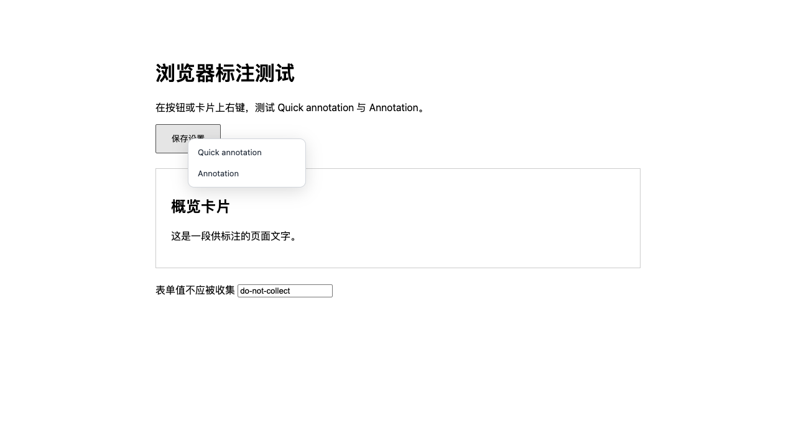

# 验证记录

日期：2026-11-15。开发适配依据：本机 DSH Desktop 0.14.0、DS Bot 0.3.6 的安装源码。当前版本：0.1.0-alpha.1。

## 已通过

- `npm run check`：19 项测试全部通过，包含 DOM double 的菜单与批量流程、HTTP 下缺少 randomUUID 的情况、草稿保护、跨会话隔离、重复交付、输入忙时保留、旧补丁冲突、卸载竞态和包结构。
- DSH client module loader 格式及 public composer slot 注册通过隔离测试；生成的 client.js 与源文件一致，JavaScript 语法检查通过。
- 真实 Chromium，通过 Playwright CLI 在路由拦截提供的 HTTP 测试页执行：恰好两个菜单项、白色背景、Quick 生成一条引用并隐藏 URL token、批量生成两条备注、切换会话阻止交付、dispose 移除页面 UI。页面错误为零。
- 浏览器测试发现 `crypto.randomUUID` 在非安全 HTTP origin 不存在，已改用 `crypto.getRandomValues` 回退并添加回归。
- 索引生成器的测试数据通过本机 DSH 的 `parseMarketIndex`，生成固定 commit 的 Git 安装参数。测试使用 example 账号和测试 SHA，仅用于格式校验，不是有效发布地址。

页面截图：

## 尚未验证

- 通过 DSH 插件管理器安装到真实 profile、公共 slot 的实际渲染、Desktop webview → 聊天草稿完整交付、停用再启用及重启。
- 原有 annotation v3 补丁退出后与独立版的迁移流程。
- Windows/Linux、其他 Desktop/DS Bot 版本、GitHub 远程安装及社区市场收录。

当前工作没有修改任何已安装 DS Bot 文件，没有迁移现有补丁或重启 DSH。已有 CLI/Finder 维护策略保持原状。

## 首次安装验收

1. 迁移旧补丁后，插件管理器显示已应用；输入框出现“网页标注”。
2. 在右侧浏览器打开测试页，右键出现两项白色菜单。
3. 预先输入草稿并选中文字；Quick 插入后原草稿仍在，不自动发送。
4. 两个元素各填写备注，完成后只插入一组标注。
5. 处理跨会话切换、网页刷新、输入框暂忙时的结果，无串写或重复插入。
6. 停用后菜单消失，再启用恢复；重启后仍可用。

验收通过前只应标记 alpha 测试版，不能将单元测试或独立 Chromium 测试当作 Desktop 验收。
