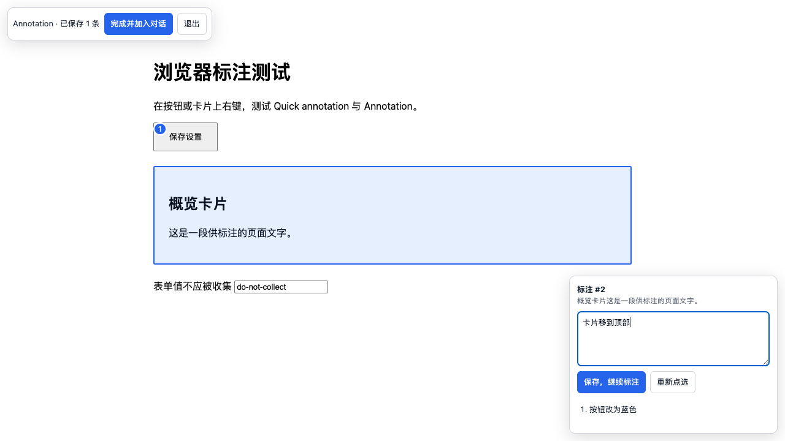

# 验证记录

## 0.1.3 · 2026-11-20 · 右键即编辑

在独立 Chromium 演示页中拖选“通过邮件通知我”，在文字上右键选择「标注」，确认右下角输入框立即获得焦点，选中文字逐行显示绿色，完成后的草稿只引用选中的文字。以按钮为目标开始第二次标注时，悬停另一元素同时显示绿色已选和蓝色候选，并保留输入焦点；单击后更换目标并保留备注。继续标注、英文 placeholder 和完成后的页面清理通过。用户已在本地浏览器试用并确认交互。真实 Desktop 的就地升级与端到端交付仍待现场验证。

## 0.1.2 · 2026-11-20

加入中英文菜单、面板、确认提示和草稿字段。24 项自动测试通过，覆盖页面语言优先级、无语言声明时的回退，以及输入备注期间切换语言。

在隔离 Chromium 中使用正式客户端构建验证了中文标注、英文快速标注、英文批量标注写入测试对话草稿。修改页面的语言声明后，面板原位切换语言，输入焦点和原文均保留。三张演示图已同步更新。真实 Desktop 的升级和端到端使用待现场验收。

## 0.1.1 · 2026-11-20

右键选择 Annotation 后进入十字选取，点击元素后在右下角填写备注。完成、继续、退出以及已保存的单行摘要都在同一面板。

- 21 项自动测试通过，包括选取与编辑的切换、已保存备注的交付和结束后的清理。
- 在隔离 Chromium 中，从概览卡片打开菜单，移动鼠标到“保存设置”并点击，确认选框跟随鼠标、备注框获得焦点、网页按钮未被误触。验证了单条完成和连续标注两条路径。两条备注按顺序追加到测试草稿，结束后网页按钮可正常点击。
- README 的第二张图取自本版演示。真实 Desktop 的安装、重启及 webview 到当前会话草稿的端到端流程待现场验证。

## 0.1.0 · 2026-11-20

本版移除了聊天输入框的 Annotate 按钮，网页右键标注默认开启。19 项自动测试通过。隔离 Chromium 演示验证了网页标注写入对话草稿，并确认输入框中已移除该按钮。真实 DSH Desktop 的 Market 就地升级、重启及端到端交互仍待现场验证。

## 0.1.0-alpha.1 历史记录

日期：2026-11-15。开发适配依据：本机 DSH Desktop 0.14.0、DS Bot 0.3.6 的安装源码。当时验证版本：0.1.0-alpha.1。

## 已通过

- `npm run check`：19 项测试全部通过，包含 DOM double 的菜单与批量流程、HTTP 下缺少 randomUUID 的情况、草稿保护、跨会话隔离、重复交付、输入忙时保留、旧补丁冲突、卸载竞态和包结构。
- DSH client module loader 格式及 public composer slot 注册通过隔离测试；生成的 client.js 与源文件一致，JavaScript 语法检查通过。
- 真实 Chromium，通过 Playwright CLI 在路由拦截提供的 HTTP 测试页执行：恰好两个菜单项、白色背景、Quick 生成一条引用并隐藏 URL token、批量生成两条备注、切换会话阻止交付、dispose 移除页面 UI。页面错误为零。
- 浏览器测试发现 `crypto.randomUUID` 在非安全 HTTP origin 不存在，已改用 `crypto.getRandomValues` 回退并添加回归。
- 索引生成器的测试数据通过本机 DSH 的 `parseMarketIndex`，生成固定 commit 的 Git 安装参数。测试使用 example 账号和测试 SHA，仅用于格式校验，不是有效发布地址。

页面截图：

## 尚未验证

- 通过 DSH 插件管理器安装到真实 profile、公共 slot 的实际渲染、Desktop webview → 聊天草稿完整交付、停用再启用及重启。
- 原有 annotation v3 补丁退出后与独立版的迁移流程。
- Windows/Linux、其他 Desktop/DS Bot 版本及社区市场收录。

当前工作没有修改任何已安装 DS Bot 文件，没有迁移现有补丁或重启 DSH。已有 CLI/Finder 维护策略保持原状。

## alpha.1 首次安装验收清单

1. 迁移旧补丁后，插件管理器显示已应用；输入框出现“网页标注”。
2. 在右侧浏览器打开测试页，右键出现两项白色菜单。
3. 预先输入草稿并选中文字；Quick 插入后原草稿仍在，不自动发送。
4. 两个元素各填写备注，完成后只插入一组标注。
5. 处理跨会话切换、网页刷新、输入框暂忙时的结果，无串写或重复插入。
6. 停用后菜单消失，再启用恢复；重启后仍可用。

验收通过前只应标记 alpha 测试版，不能将单元测试或独立 Chromium 测试当作 Desktop 验收。

## 2026-11-16 安装与卸载验收

对象：已发布的 `github:chnuuh/dsh-browser-annotation#v0.1.0-alpha.1`，解析到 commit `93368d5d118215c5b095f27659f401ea95ef3e43`。本地文档基线为 `14b4551`，两者运行文件一致。

环境：macOS、DSH Desktop 0.14.0 自带的 DSH CLI、pnpm 12.5.1。设置独立 `DSH_HOME`，使用无用户数据的 `annotation-check` profile；没有修改运行中的 Desktop profile。

- **通过：GitHub 安装。** 官方 `dsh plugin --profile annotation-check add` 成功，退出码 0。依赖与 `dsh.profile.bundles` 均登记该插件，无需执行安装脚本。
- **通过：bundle 识别。** 官方 `--dump-config` 显示唯一的 `dsh-browser-annotation` 插件行及版本 `0.1.0-alpha.1`；安装后的 `client.js`、`index.js`、`cordis.patch.yml` 与本地基线逐字节一致。
- **通过：卸载。** 官方 `dsh plugin --profile annotation-check remove dsh-browser-annotation` 成功，退出码 0；卸载后 `--dump-config` 为空。
- **尚未验证：真实 Desktop UI。** 当前自动化浏览器入口不可用；独立 Playwright 浏览器访问运行中的 DSH 返回 HTTP 401、`authentication required`。尚未进入已认证的 Desktop 窗口，不能验证 public slot 渲染、webview 到草稿交付、停用再启用和重启。
- **未执行：旧补丁迁移。** 磁盘检查确认旧 Annotation v3 仍在，Finder 注册仍停用，CLI 续跑补丁仍在；本轮没有改动这些安装文件。

结论：安装包生命周期的安装／识别／卸载已通过，Desktop 现场验收仍未完成。普通浏览器的 iframe 不能代替 Electron webview 验收。

2026-11-16 发布决定：维护者决定暂缓剩余 Desktop 现场验收，先以 alpha 状态提交市场收录 Draft PR，并在 PR 中披露验证范围。该决定不等于现场验收通过。仓库创建满 24 小时后才满足目录的仓库年龄要求；收录由目录维护者审核决定。
